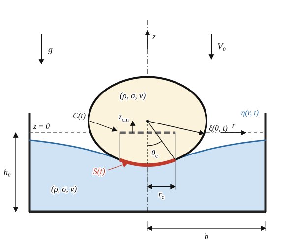

# A fully spectral kinematic match for droplet–bath impact: model formulation

*Text and notation follow §3 of Alventosa, Cimpeanu & Harris (2023, *J. Fluid Mech.* **958**, A24; arXiv:2209.13276) with minimal edits. Their sentences are kept wherever the model is unchanged. The departures are: (i) the single-point match and the assumed pressure profile are replaced by a spectral pressure solved for over the whole contact region (§3.3–3.4); (ii) the bath radius $b$ is kept as a model parameter of a few droplet radii (Alventosa et al. use the same cylinder with $b=25R$), the finite-radius derivation is written out (§3.1), and the Fourier–Bessel normaliser is corrected; (iii) BDF2 replaces backward Euler. Three closure choices are independent options and are collected as separate tracks in §3.7: the contact edge (A), the droplet viscous closure (B) and the wall condition (C). Derivations and audits: `derivations/`.*

## 3. Linearized quasi-potential fluid model

In this section, we develop a model for droplet impact on a flat fluid interface from first principles. First, we use the linearized Navier–Stokes equations to model the flow within the bath and the shape of the bath interface. Then, we use an orthogonal function decomposition of the bath model to derive a single set of linear ordinary differential equations (ODEs) that govern the bath mode amplitudes. We then write a similar model for the droplet interface, which reduces to another set of linear ODEs governing droplet mode amplitudes. Finally we represent the pressure distribution and its extent acting on the bath and droplet during contact by a spectral series, couple the two sets of ODEs together using a kinematic match condition enforced over the whole contact region, and solve the system implicitly.

**Figure 1.** A drop in contact with the bath (not to scale). On the pressed surface $S(t)$ the two interfaces coincide; its projection on $z=0$ is $C(t)$, of radius $r_c(t)$.

### 3.1. Bath interface model

The bath interface dynamics are modelled using a linearized, quasi-potential flow model following Galeano-Rios et al. (2017) and Dias et al. (2008). Assuming the flow to be incompressible, isothermal, and Newtonian, we can define the fluid velocity vector $\mathbf u=\nabla\phi+\nabla\times\boldsymbol\Psi$ and the bath interface shape $\eta=\eta(r,t)$. Here, $\phi$ is the scalar potential and $\boldsymbol\Psi$ is the vector stream function. We then linearize the governing equations and boundary conditions about the undisturbed free surface $z=0$, and recast them as

$$
\nabla^2\phi+\partial_z^2\phi=0,\quad z\le0;\qquad \partial_t\eta=\partial_z\phi+2\nu\nabla^2\eta,\quad z=0,\qquad\text{(3.1–3.2)}
$$

$$
\partial_t\phi=-g\eta-2\nu\,\partial_z^2\phi+\sigma\kappa/\rho-p_s/\rho,\quad z=0.\qquad\text{(3.3)}
$$

Here, $p_s(r,t)$ is the contact pressure, $g$ is the gravitational acceleration, $\kappa=\nabla^2\eta$ is twice the linearized mean curvature of the interface, $h_0$ is the depth of the undisturbed bath, and $\rho,\sigma,\nu=\mu/\rho$ are the fluid density, surface tension, and kinematic viscosity, respectively. The tangential stress boundary conditions are automatically satisfied in these approximations. This leading-order theory is valid in the weakly viscous limit when $\mathrm{Re}\gg1$, where $\mathrm{Re}$ is $\mathrm{We}^{1/2}$ over $\mathrm{Oh}$.

Here $\nabla^2=\partial_r^2+r^{-1}\partial_r$ is the axisymmetric horizontal Laplacian. The bath occupies the cylinder $0\le r\le b$, $-h_0\le z\le0$ after linearization (figure 1), and (3.1)–(3.3) must be closed on the three remaining boundaries, the bottom, the wall and the axis. We assume that the impact occurs in a bath of some viscous fluid contained in a cylinder of finite radius $b$ and depth $h_0$, subject to no flux through the bottom and through the wall (Benjamin & Ursell 1954),

$$
\partial_z\phi(r,-h_0,t)=0,\qquad\text{(3.4a)}
$$

$$
\partial_r\phi(b,z,t)=0,\qquad-h_0\le z\le0,\qquad\text{(3.4b)}
$$

together with regularity on the axis of symmetry and a constant $90^\circ$ contact angle at the wall,

$$
\partial_r\phi(0,z,t)=0,\qquad\partial_r\eta(0,t)=0,\qquad\text{(3.4c)}
$$

$$
\partial_r\eta(b,t)=0.\qquad\text{(3.4d)}
$$

Conditions (3.4b) and (3.4d) are compatible: differentiating (3.2) in $r$ at $r=b$ and using (3.4b) at every depth gives $\partial_t\partial_r\eta(b,t)=2\nu\,\partial_r\nabla^2\eta(b,t)$, which is $O(\nu)$, so a wall slope that is initially zero stays zero to leading order. The finite radius is therefore a boundary condition and not merely a truncation: the walls reflect the waves radiated by the impact. For $h_0\to\infty$, (3.4a) is replaced by decay, $\phi\to0$ as $z\to-\infty$, and $\tanh(k_mh_0)\to1$ below; for $b\to\infty$, (3.4b) and (3.4d) are replaced by decay as $r\to\infty$, and the discrete sums below become Hankel integrals. These limits are not used here: $b$ is a model parameter of a few droplet radii. In the axisymmetric case the horizontal structure is the eigenproblem

$$
r^{-1}\partial_r(r\,\partial_rS)+k^2S=0,\quad0<r<b;\qquad S\ \mathrm{regular\ at}\ r=0,\qquad\partial_rS(b)=0,\qquad\text{(3.5)}
$$

whose solutions are $S=J_0(kr)$, with $J_0$ the Bessel function of the first kind, and $k=k_m$ the roots of $J_0'(k_mb)=0$, i.e. $J_1(k_mb)=0$, together with the constant solution $k_0=0$ (the piston mode). (The second Bessel solution $Y_0$ is singular at $r=0$ and is excluded by regularity.) For convenience we define $k_{0,m}=k_m$ henceforth. We then can express the free surface elevation as

$$
\eta(r,t)=\sum_{m=0}^{M}a_m(t)J_0(k_mr),\qquad\text{(3.6)}
$$

Each $J_0(k_mr)$ satisfies $(\nabla^2+k_m^2)J_0=0$ and, because $J_0'(k_mb)=0$, the wall condition (3.4b) at every depth. Writing $\phi=\sum_m\phi_m(t)J_0(k_mr)Z_m(z)$, Laplace's equation (3.1) gives $Z_m''=k_m^2Z_m$, and the bottom condition (3.4a) selects $Z_m=\cosh k_m(z+h_0)/(k_m\sinh k_mh_0)$, normalised so that $Z_m'(0)=1$. The kinematic condition (3.2) then fixes $\phi_m=\dot a_m+2\nu k_m^2a_m$, so

$$
\phi=\sum_{m=0}^{M}\big(\dot a_m+2\nu k_m^2a_m\big)J_0(k_mr)\,Z_m(z),\qquad \kappa=-\sum_{m=0}^{M}k_m^2a_mJ_0(k_mr).\qquad\text{(3.9)}
$$

The functions $J_0(k_mr)$ are orthogonal under the weight $r$ on $[0,b]$, with $\int_0^bJ_0(k_mr)^2\,r\,dr=\tfrac12b^2\big[J_0(k_mb)^2+J_1(k_mb)^2\big]=\tfrac12b^2J_0(k_mb)^2$ since $J_1(k_mb)=0$. Substituting (3.9) into the dynamic condition (3.3), using $\partial_z^2\phi=k_m^2\phi$ mode by mode, projecting onto $J_0(k_mr)$, multiplying by $k_m\tanh(k_mh_0)$ and dropping the $O(\nu^2)$ term $4\nu^2k_m^4a_m$ (consistent with the weakly viscous limit), each wave mode in the bath is described by a forced, damped harmonic oscillator equation,

$$
\ddot a_m+4\nu k_m^2\dot a_m+\Big(\sigma k_m^2/\rho+g\Big)k_m\tanh(k_mh_0)\,a_m=-\,(d_m/\rho)\,k_m\tanh(k_mh_0),\qquad\text{(3.10)}
$$

where $d_m$ are the Fourier–Bessel coefficients of the pressure, $p_s=\sum_m d_mJ_0(k_mr)$,

$$
d_m=\frac{2}{(bJ_0(k_mb))^2}\int_0^b p_s(r)\,r\,J_0(k_mr)\,dr.\qquad\text{(3.21)}
$$

The preprint prints $J_1$ in this normaliser; $J_0(k_mb)$ is what the orthogonality relation above gives. The finite radius enters only through the discrete spectrum $J_1(k_mb)=0$ and this norm. Two consequences are used later. The piston mode $k_0=0$ is the only mode that carries volume ($\int_0^bJ_0(k_mr)\,r\,dr=bJ_1(k_mb)/k_m=0$ for $k_m\ne0$), and its forcing coefficient $k_0\tanh(k_0h_0)$ vanishes, so bath volume is conserved exactly. As $b\to\infty$ the zeros of $J_1$ become evenly spaced by $\pi/b$ and the sums tend to Hankel integrals, the deep-bath limit that $b=25R$ approximates; at $b$ of a few $R$ the discrete spectrum is a physical property of the container.

### 3.2. Droplet interface model

Additionally, we wish to recover a similar set of equations that describe the gravity-capillary waves present in the droplet, and then couple these equations to the motion of the bath. The full derivation of the droplet oscillation model can be found throughout prior works (Lamb 1924; Tsamopoulos & Brown 1983; Courty et al. 2006; Chevy et al. 2012; Balla et al. 2019) and is briefly summarized below. We begin by utilizing spherical harmonics to decompose the droplet radius in a spherical domain; due to the axisymmetry of the problem they reduce to Legendre polynomials, $\xi(\theta,t)=R+\sum_l\beta_l(t)P_l(\cos\theta)$. We assume that the velocity potential takes the same form as the decomposition of the interface (Lamb 1924; Balla et al. 2019), and turn to an energy conservation equation of the form $dT/dt=\dot W-\varepsilon$, with $T=K+G$, $\dot W$, and $\varepsilon$ the total energy of the drop, the rate of work done on the droplet interface, and the viscous dissipation, respectively. Utilizing the linearized kinematic boundary condition yields a set of forced, damped harmonic oscillators that describe the amplitude of each individual spherical mode,

$$
\ddot\beta_l+2\alpha_l\dot\beta_l+\omega_l^2\beta_l=-\frac{(2l+1)l}{2\rho R}\,\Pi_l+g\,\delta_{1l},\qquad\text{(3.14)}
$$

with $\alpha_l=(2l+1)(l-1)\mu/(\rho R^2)$ and $\omega_l^2=l(l-1)(l+2)\,\sigma/(\rho R^3)$. Here $\Pi_l$ is the projection of the pressure on mode $l$. In Alventosa et al. it is $\int_0^\pi p_s\sin\theta P_l\,d\theta$; we use $\Pi_l=\int_{x_c}^1p_s\,x\,P_l\,w\,dx$ with $x=\cos\theta$ and $w=-\tfrac12\,d(r^2)/dx$ (the area element, $r\,dr=w\,dx$). This differs from theirs at $O(\theta_c^2)$, reduces to it as $\theta_c\to0$, and makes the contact operator of §3.6 self-adjoint. The mode $l=1$ is the translational mode, i.e. the centre of mass, $\beta_1=-z_{cm}$. This model is valid in the weakly viscous limit, when $\mathrm{Oh}\ll1$; the closure for $\alpha_l,\omega_l$ is track B (§3.7).

### 3.3. Pressure forcing during impact

There is still an additional unknown in the bath mode (3.10) and drop mode (3.14) equations: the applied pressure distribution $p_s(r,t)$. However, in this work, we will assume that the viscosity of the ambient gas is small relative to the fluid bath such that the flow within the small air film is negligible, and the pressure acts solely to apply an upwards hydrodynamic force on the droplet. The radial extent of the pressure distribution is generally unknown for impact problems, and constitutes an additional problem that we must solve. The contact region, $A_c$, will be assumed to be a simply-connected disk, following Galeano-Rios et al. (2017) and Korobkin (1995), which allows us to write a single unknown $\theta_c(t)$, with $x_c=\cos\theta_c$, to fully describe the temporal evolution of this region of contact.

Unlike Alventosa et al., who assume a profile $p_s=F(t)H_r(r/r_c)/\pi R^2$ with $H_r=C[1-(r/r_c)^6]$, we assume no spatial profile. With $\psi=(x-x_c)/(1-x_c)\in[0,1]$, the pressure is a shifted-Legendre series in $x$,

$$
p_s=\frac{2\sigma}{R}\sum_{n=0}^{N}\hat c_n(t)\,\tilde P_n(\psi)\quad(x\ge x_c),\qquad p_s\equiv0\quad(x<x_c),\qquad\text{(3.17)}
$$

with $\tilde P_n(\psi)=P_n(2\psi-1)$. Each $\tilde P_n$ is exactly a degree-$n$ polynomial in $x$, the basis is orthogonal on the patch (Gram condition number $2N+1$, against Hilbert-matrix growth for monomials), and the vanishing of the pressure outside the patch is exact and costs no equations. The coefficients $\hat c_n$ are unknowns, determined by the kinematic match below. Substituting (3.17) into (3.10) and (3.14), the pressure enters only through its moments $c_m$ (the dimensionless $d_m$), $b_l$ (the dimensionless $\Pi_l$) and the net force $f$, computed by Gauss–Legendre quadrature. The droplet and centre-of-mass integrands are polynomial in $x$, so the quadrature is exact once the number of nodes $n_q$ exceeds half their degree; the bath integrals contain $J_0(k_mr(x))$ and are quadrature-approximate. The $l=1$ mode, $\beta_1=-z_{cm}$, reduces to Newton's law for the centre of mass, $\ddot z_{cm}=F/m-g$ (3.25), with $m=\tfrac43\pi\rho R^3$ the droplet mass and $F$ the integral of the pressure over the contact area.

### 3.4. Modeling contact

The contact pressure is determined through a kinematic match condition. Alventosa et al. enforce contact only at a single point, the centre of the axisymmetric domain (the "1-Point" kinematic match, 1PKM), $\eta(0,t)=z_{cm}(t)-\xi(0,t)$, which determines the unknown contact force $F(t)$. We instead enforce contact throughout the contact region, the full kinematic match of Galeano-Rios et al. (2017, 2019, 2021) and Agüero et al. (2026), which circumvents the need for any assumption on the pressure profile shape. Writing $r(\theta)=\xi\sin\theta$, $z_d(\theta)=\xi\cos\theta$ for the droplet surface in the bath frame,

$$
C(\theta)\equiv\eta(r(\theta),t)-z_{cm}(t)+z_d(\theta)=0,\qquad0\le\theta\le\theta_c.\qquad\text{(3.26)}
$$

With $N+1$ coefficients this cannot hold pointwise, so it is imposed in the weighted-residual sense by testing against the pressure basis,

$$
\int_{x_c}^{1}C(\theta)\,\tilde P_n(\psi)\,w\,dx=0,\qquad n=0,\dots,N,\qquad\text{(3.26')}
$$

a square system for $\hat c_n$ at fixed $\theta_c$. Contact ends when the two surfaces, advanced one step with no pressure, no longer overlap, as in Agüero et al. (2026), whose zero-contact candidate has tangency error 0 when it does not overlap and is rejected otherwise. No condition is placed on the sign of the force. (Alventosa et al. end contact when the force becomes negative; that rule is kept as `contact_end = :force`.)

The match (3.26') fixes the pressure once the contact extent $\theta_c(t)$ is known, but it does not by itself fix $\theta_c$. That choice, like the droplet viscous closure of §3.2 and the wall condition of §3.1, admits more than one closure, and stating the closures needs the time-discretised operators of §3.6; they are therefore collected as independent tracks in §3.7. The default for the contact edge is the largest crossing of the two surfaces (track A1). Contact begins at the first step where the surfaces, advanced without pressure, overlap anywhere ($\max_\theta C>0$), with $\theta_c$ seeded from the outer edge of the overlap. A zero patch is then inadmissible by construction: with no pressure, that overlap remains.

### 3.5. Summary

Choosing a timescale of $t_\sigma=\sqrt{\rho R^3/\sigma}$ (with $\tau=t/t_\sigma$), a length scale of $R$, a pressure scale of $2\sigma/R$, and a force scale of $2\pi\sigma R$ (with $f=F/2\pi\sigma R$), we recast the governing equations in non-dimensional form,

$$
\eta=\sum_{m=0}^{M}a_m(\tau)J_0(k_mr),\qquad \xi=1+\sum_{l=2}^{L}\beta_l(\tau)P_l(\cos\theta),\qquad\text{(3.27–3.28)}
$$

$$
\ddot a_m+2\gamma_m\dot a_m+\omega_m^2a_m=-2\,c_m\,k_m\tanh(k_mh_0),\qquad\text{(3.29)}
$$

with $\gamma_m=2\,\mathrm{Oh}\,k_m^2$ and $\omega_m^2=(k_m^2+\mathrm{Bo})\,k_m\tanh(k_mh_0)$,

$$
\ddot\beta_l+2\gamma_l\dot\beta_l+\omega_l^2\beta_l=-\,b_l\,(2l+1)\,l,\qquad\text{(3.30)}
$$

with $\gamma_l=\mathrm{Oh}\,(2l+1)(l-1)$ and $\omega_l^2=l(l-1)(l+2)$,

$$
\ddot z_{cm}=\tfrac32f-\mathrm{Bo},\qquad\text{(3.31)}
$$

$$
\int_{x_c}^{1}\big[\eta(r(\theta),\tau)-z_{cm}(\tau)+z_d(\theta)\big]\tilde P_n(\psi)\,w\,dx=0,\quad n=0,\dots,N,\qquad\text{(3.32)}
$$

with $c_m=\frac{2}{(bJ_0(k_mb))^2}\int p\,J_0(k_mr)\,r\,dr$, $b_l=\int_{x_c}^1p\,x\,P_l\,w\,dx$ and $f=2\int_{x_c}^1p\,w\,dx$, where $p$ is the pressure (3.17) scaled by $2\sigma/R$. Equations (3.29) and (3.30) describe the evolution of the bath and droplet oscillation modes, respectively. Equation (3.31) governs the vertical motion of the droplet's center of mass. Equation (3.32) couples these equations all together and, with the contact-edge rule of §3.7 (track A), allows for determination of the unknowns $\hat c_n(\tau)$ and $\theta_c(\tau)$. The shape of the bath and droplet can be reconstructed at any time via the sums in (3.27) and (3.28). The complete model is valid when $\mathrm{Re}\gg1$ (with $\mathrm{Re}$ as above); $\mathrm{Oh}\ll1$ for the Lamb closure only. Also, since the model is linearized about the undeformed state, we anticipate it to hold when deformations remain small, further suggesting $\mathrm{Bo}\ll1$ and $\mathrm{We}\ll1$. The system is closed once the three closure choices of §3.7 are made; the defaults are the largest crossing (A1) for the contact edge, Reid's exact rates (B2) for the droplet viscosity and the free no-flux wall (C1).

### 3.6. Numerical methods

We solve these equations using an implicit method, as the instantaneous size of the pressure distribution acting on both the droplet and bath at the next time step is unknown (Galeano-Rios et al. 2021); treating the pressure explicitly on either the droplet or the bath can lead to nonphysical behavior in the system. We use variable-step second-order backward differentiation (BDF2) rather than backward Euler. Each oscillator $\ddot u+2\gamma\dot u+\omega^2u=Fq$ of (3.29)–(3.31) then makes its state affine in its own pressure moment at the new level,

$$
u^{k+1}=\mathrm{history}+\kappa\,q^{k+1},\qquad \kappa=\delta^2F/(\mathfrak a^2+2\gamma\mathfrak a\,\delta+\delta^2\omega^2),\qquad\text{(3.33)}
$$

with step $\delta$ and BDF2 leading coefficient $\mathfrak a=(1+2s)/(1+s)$ for step ratio $s$. Hence $\eta$, $\xi$ and $z_{cm}$ are explicit affine functions of $\hat c$, and each time step reduces to the algebraic system (3.32). Writing $C=C_{\rm free}+\mathcal Ap$ at frozen geometry, the compliance operator $\mathcal A$ is self-adjoint and negative semidefinite in $\int uv\,w\,dx$, with a numerical rank that grows with $M$ and $L$ (7, 9, 14 at $M=L=20,40,80$). Refining $N$ at fixed $M,L$ therefore stops adding information once $N$ exceeds that rank, but $N$ can be raised together with $M$: at one water contact step and fixed $\theta_c$, $N=3\to32$ with $M=160\to640$ gives Legendre coefficients decaying to $10^{-8}$ and the pressure converged to three digits at five points on a small patch ($\theta_c=0.17$); on a large patch ($\theta_c=0.93$) the interior pressure and the force converge but the edge value does not, which points to an edge singularity that a polynomial basis cannot follow. The default $N=3$ is cheap, not converged: at fixed $\theta_c$ it is 0.9–2.8% off in the force. Because $\theta_c$ is held fixed during each inner solve, the inner system has condition number of order one and flat in $\delta$, against order $10^{18}$ for a joint $(\hat c,\theta_c)$ system. It is solved by Levenberg–Marquardt-damped Newton with a forward-mode automatic-differentiation Jacobian. That solver judges convergence by an absolute residual, $\lVert R\rVert<10^{-7}$, while the residual scales with the patch area; on the first and last contact steps it accepts the starting guess or an unconverged iterate. On the water impact $\mathrm{We}=1.0958$ the accepted force differs from the solution of the same equations by more than 5% on 14 of 195 steps (opposite sign on 6), all in the first three or the last ten; mid-contact the two agree to better than 1%. The default solver is now a scale-invariant minimum-norm Gauss–Newton solve (`minnorm_gauss_newton`). On small patches the Jacobian is rank-deficient to working precision (condition numbers $10^{8}$–$10^{14}$ for $\theta_c<0.05$ at $M=L=60$), because the truncated modes cannot resolve pressure structure finer than their shortest wavelength. The solver therefore truncates the pseudo-inverse, trying the strongest truncation first and stopping at the first level that satisfies every equation; if none does, it keeps the most truncated level that converged. Trying the weakest truncation first instead returned, at $\mathrm{We}=0.0231$, a 'converged' step with net force $7.8\times10^{30}$. The old solver is deprecated (`solver = :newton`). With equations that are actually solved, coarse truncations no longer degrade quietly. At $M=L=40$ and below, the early contact steps produce sign-alternating forces of order $10^2$, and the run stops at the overlap check (§3.4). The default $M=60$, $L=120$ is clean, and so is $M=L=120$. Defaults are $M=60$, $L=120$, $N=3$, $n_q=200$, with a bath of radius $b=6$ (Alventosa et al.: $M=150$, $L=55$, $b=25R$, no pressure unknowns). Convergence is judged on contact time.

### 3.7. Closure tracks

Three parts of the model admit more than one closure. Each is an independent option, selected by its own keyword in `Params`, and any combination can be run. The tracks are not nested: changing one leaves the equations of the others untouched. Defaults are marked.

#### Track A: contact edge $\theta_c$ (`selector`)

The kinematic match (3.26') is solved at a given $\theta_c$; the tracks differ in how $\theta_c$ is chosen. Tangency, $\partial_\theta C(\theta_c)=0$, holds trivially at $\theta=0$ by axisymmetry, but that root is never a candidate: contact starts because the unpressed surfaces overlap, which a zero patch leaves in place.

**A1. Largest crossing (`:crossing`, default).** Following Alventosa et al., the predictions of both interfacial models, advanced one step without pressure, are used to find the exact location where the two interfaces cross, and the largest crossing is the instantaneous edge of contact, held at its previous value when there is none, with $\theta_c$ clamped to $[\arcsin0.01,\arcsin0.9998]$ (the clamps of their reference implementation). Since $C$ is the vertical gap between the surfaces at radius $r(\theta)$, a root of $C$ is an intersection of the two curves. The rule is a predictor for the support of $p$: pressure pushes the surfaces apart, so the region it must press is bounded by where the unpressed surfaces overlap. This holds for the centre-of-mass and low-order bath contributions to $\mathcal A$ but is not guaranteed pointwise for its oscillatory high-wavenumber part. It is a closure inherited from 1PKM, not a derived free-boundary condition, and it carries no error bound.

**A2. Feasible set (`:feasible`, retained for reproduction).** With $\Theta$ the set of $\theta$ for which the surfaces do not overlap beyond $\theta$ and $\partial_xr<0$ at the state the pressure solving (3.26') induces,

$$
\theta_c=\inf\Theta.\qquad\text{(3.34)}
$$

Near the edge $C\sim a(\theta-\theta_c)$ and non-overlap is the inequality $a\le0$, so once $a<0$ the infimum is $0$ regardless of the size of $a$: the rule is degenerate, and at high $\mathrm{We}$ it can collapse the patch and lose contact (oil, $\mathrm{We}=7.307$: contact lasts $0.19$ against $5.26$ measured). The run then stops with an error: it used to continue in free flight with the drop passing through the bath, because nothing checked for overlap off the axis.

**A3. Complementarity (`:signorini`, experimental, not the default).** If the air film cannot sustain suction, the closure is a unilateral (Signorini) contact condition: the pressure is non-negative, the surfaces may not overlap, and pressure acts only where they touch,

$$
p\ge0,\qquad C\le0,\qquad p\,C=0\qquad(0\le\theta\le\pi).\qquad\text{(3.26a)}
$$

At frozen geometry $C=C_{\rm free}+\mathcal Ap$ (§3.6), with $C_{\rm free}$ the mismatch produced by the time-stepping history alone and $-\mathcal A$ symmetric positive semidefinite in $\langle u,v\rangle_w=\int uv\,w\,dx$. Then (3.26a) are precisely the optimality conditions of the convex problem

$$
\min_{p\ge0}\ \tfrac12\langle p,(-\mathcal A)p\rangle_w-\langle p,C_{\rm free}\rangle_w,\qquad\text{(3.26b)}
$$

so the gap response $\mathcal Ap$ is unique, and the contact set $\{p>0\}$ is part of the solution rather than an input. The sign condition $p\ge0$ is an assumption about the film, not a result, and neither parent model imposes it pointwise; the implemented tracks A1 and A2 do not either. Track A3 solves (3.26b) directly, which determines the contact set rather than assuming it, but imposes $p\ge0$; whether the film can in fact sustain suction is a question about its physics that the model does not settle. Tangency, $\partial_\theta C(\theta_c)=0$, is the usual consequence at the edge of the set.

*A shifted pressure is not a way around the sign condition.* Adding a constant $C_0$ to the film and to the ambient everywhere is a gauge change: a uniform pressure on the whole bath surface excites no mode ($\int_0^bJ_0(k_mr)\,r\,dr=bJ_1(k_mb)/k_m=0$, and the piston forcing $k_0\tanh(k_0h_0)=0$), and on the whole drop it excites only $l=0$ under the projection of Alventosa et al. Because it is a gauge change it cannot change the contact law: written in $p^*=p+C_0$, the unilateral law is $p^*\ge C_0$, $(p^*-C_0)\,G=0$ with $G$ the opening, which is again $p\ge0$. Imposing $p^*\ge0$ instead is a new law, $p\ge-C_0$ with $C_0$ a physical floor (the ambient pressure, if $p^*$ is absolute). That law is not of the form (3.26a): a separated surface has $p^*=C_0\ne0$. Its graph $\{G=0,\ p\ge-C_0\}\cup\{G>0,\ p=0\}$ is not monotone, so it is not the optimality condition of any convex problem. With $C_0$ the atmospheric pressure it would never bind: in units of $2\sigma/R$ at $R=0.35$ mm it is 246 (water) and 865 (oil), against a largest suction of 16 in these runs. The pressure projection $b_l$ used here is exact only on a polar patch; over the whole sphere it would force $l=2$ with $-8C_0/3$, so the shift must not be applied through it. Checked in `derivations/verify_gauge_shift.py`.

Consistency of the edge chosen by A1 or A2 with (3.26a) is checked rather than assumed. The tangency residual $\partial_\theta C(\theta_c)$ is reported at every contact step, and $\min p$ on the patch and the overlap beyond the edge can be evaluated from the stored state. Measured on the water impact $\mathrm{We}=1.0958$ at $M=L=60$, $N=3$, $n_q=40$, the pressure is negative somewhere on the patch on 38% of contact steps under A1 (worst value $-16$, against a peak of $16$), and on 2% under A2 (201 sample points per step). Negative pressure is therefore a property of the edge rule here and not only of the truncation: A1 presses a region that a non-negative pressure could not support. Raising $N$ to 12 makes it worse under A1 (97%). The contact radius also peaks earlier than in the DNS ($\tau\approx0.89$ against $1.46$, a figure from an earlier run that I have not reproduced).

*Choice of defaults by experiment.* The defaults for the inner solver and the end of contact were chosen by the rule agreed before the runs: the lowest weighted standardised mean squared error over the 17 bath experiments (contact time, coefficient of restitution, penetration depth), with weights $\mathrm{We}^{-\log_{10}2}$ so that a point one decade lower in $\mathrm{We}$ counts twice, and no failed point allowed (`scripts/score_vs_experiment.jl`, `scripts/score_summary.jl`). With A1: original solver and force end 18.358; original solver and geometric end 18.351; corrected solver and geometric end 18.378; corrected solver and force end fails on 12 of 17 points. A4 with the corrected solver and geometric end fails on 13 of 17 (all oil, and water $\mathrm{We}=1.94$). The three eligible configurations differ by 0.15%, far below anything the data resolve, so wall time decides. Uncontended, over five points, the corrected solver takes 31.5 s against 60.4–61.8 s for the original one. The default is therefore the corrected solver with the geometric end, and the other options are deprecated. The weighted $R^2$ is negative for contact time ($-2.9$) and coefficient of restitution ($-3.05$) and $0.33$ for penetration depth: the model's gaps to experiment (oil $\alpha$ low by up to $17\sigma$, oil $\delta$ low by up to $6\sigma$) are not changed by any of these choices. Under the geometric end, contact ends from patches with $r_c\le0.06$ (checked at four impacts), i.e. within about three nodes of the grid of Agüero et al., whose search reaches the zero patch only from two nodes or fewer.

*How the metrics are read.* The experiments track the top of the drop and fit parabolas to at least 40 frames (10,000 fps) of free flight after rebound; $t_c$ and $\alpha$ come from the fit's crossing of $z=2R$ and its slope there (Alventosa et al. 2023, §2.2). The comparisons above use the centre of mass at $z=R$ with instantaneous velocities, as their model and DNS did. `fitted_rebound_metrics` applies the experimental procedure to the simulated top of the drop (`scripts/score_metric_definitions.jl`). With exactly 40 frames the weighted error falls from 18.38 to 12.66, almost entirely through oil $\alpha$ (0.139 to 0.163 at $\mathrm{We}=7.3$). With 80 frames it is 16.55, and $\alpha$ approaches the centre-of-mass value. Forty frames span about 1.3 periods of the drop's $l=2$ oscillation in oil (31 frames), so a short fit reads the oscillation phase into the exit slope. Applied to the centre of mass, the procedure reproduces the instantaneous values exactly, since free flight is ballistic. Which window the experiments used, point by point, is not stated, so the comparison cannot yet be made like for like.

*Status.* On five anchor points (two water, three oil) A1 and A2 agree to within 0.03% in contact time and 0.08% in penetration depth wherever A2 returns a result; at oil $\mathrm{We}=7.307$ only A1 does. This is not a head-to-head comparison against experiment over all 17 points.

*Implementation of A3.* The pressure is a sum of piecewise-linear hat functions in $\theta$ on a grid graded toward the pole, with $n$ nodes (default 24), so that $p\ge0$ holds everywhere exactly when every nodal value is non-negative. Testing the gap against the same hats gives the symmetric matrix $Q=-\langle\phi_i,\mathcal A\phi_j\rangle_w$ and (3.26b) in the nodal pressures. It is solved by an active-set non-negative least squares on the Jacobi-equilibrated, eigenvalue-truncated factorisation of $Q$, with the geometry iterated from a second-order extrapolation of the two previous time levels. The dynamics see only the moments $c_m$, $b_l$, $f$. The numerical rank of $Q$ follows $M$ and $L$ (17, 24, 28, 36, 38 for $n=16, 24, 32, 48, 64$ at $M=L=60$) and not $n$. The pointwise pressure and its support are therefore not converged outputs (nodal maxima range from about 1 to $10^3$ across $n$), nor is the force at a fixed state (a 20% spread across $n$). Only time-integrated observables converge.

*Status of A3.* Inside the envelope below, A3 reproduces A2 to within $1.4\times10^{-3}$ in $t_c$, $\alpha$ and $\delta$ at the five anchor points; at oil $\mathrm{We}=7.307$, where A2 fails, it agrees with A1 to $2\times10^{-3}$. It is converged in $M=L\ge60$ and in the maximum step size. It is 2–11 s per impact, against 4–14 s for A1 and 40–890 s for A2. Negative pressure carries 0.63%, 0.51%, 4.40% and 0.12% of the contact impulse under A1 (water $\mathrm{We}=1.096$ and $0.725$, oil $\mathrm{We}=1.216$ and $7.307$), so imposing $p\ge0$ can move the observables only slightly, which is why A3 and A1 agree. This is not evidence that $p\ge0$ is physically right. A3 therefore adds no accuracy over A1, and the gaps to experiment in the validation tables (for example $\alpha$ at oil $\mathrm{We}=7.3$) are not caused by the edge or sign closure. *Outside the envelope it can return wrong results without an error.* Verified envelope: `wall=:free`, $M=L\ge50$, $8\le n\le40$, $\Delta\tau_{\rm init}\in[6\times10^{-4},3\times10^{-3}]$, and a maximum step run at two values. Observed failures: coarse truncation ($M=L=30$–36: oil $\alpha$ 0.100 and 0.160 against 0.171 and 0.175 under A1, no error), $n\ge48$ at a small maximum step, and $\Delta\tau_{\rm init}\le5\times10^{-4}$, where the first contact patch is narrower than the first grid element and the onset becomes a point load. A rejection cascade raises an error, but that guard is not exhaustive, so a cross-check against A1 at the same settings is required.

**A4. Edge-pinned tangency (`:tangency`, experimental, not the default).** Agüero et al. (2026) impose, at the contact edge, that the surfaces meet and that they meet tangentially, together with no overlap beyond the edge. They impose the match at every node, so $C(\theta_c)=0$ holds by construction and tangency is the one condition left to select $\theta_c$. The Galerkin match (3.26') imposes only moments of $C$, so $C(\theta_c)\ne0$ in general, and the root of $\partial_\theta C$ then overlaps at the edge. Measured at three water steps, $C(\theta_c)=+1.2\times10^{-3}$, $+2\times10^{-4}$ and $+1.5\times10^{-4}$ at that root; the smallest-tangency-error rule then reduces to A2. Track A4 replaces the highest moment by the edge condition,

$$
\int_{x_c}^{1}C\,\tilde P_n(\psi)\,w\,dx=0\quad(n<N),\qquad C(\theta_c)=0,\qquad\text{(3.36)}
$$

and selects $\theta_c$ by $\partial_\theta C(\theta_c)=0$ among candidates with no overlap beyond the edge. With $C(\theta_c)=0$, $\partial_\theta C>0$ means overlap just outside the edge, so the root is the lower boundary of the admissible set. For a static capillary–gravity membrane indented by a sphere, the edge value and slope depend on the pressure only through $Q=\int I_0(s/\ell)\,p\,s\,ds$. The two edge conditions then fix the contact radius whatever the interior pressure, so (3.36) returns it exactly at every $N$, whereas the plain Galerkin tangency root overlaps at the edge at every finite $N$. This is checked in `derivations/verify_edge_pinning.py` and `derivations/verify_edge_pinning_model.jl`; the exactness is particular to that model, the structure is not.

*Status of A4.* Water, $\mathrm{We}=1.0958$, defaults: $t_c=4.4525$, $\alpha=0.2892$, $\delta=0.7793$, against $4.4453$, $0.2958$, $0.7799$ under A1. For $0.02<\tau<3.5$ every step has a positive force, $|\partial_\theta C(\theta_c)|\sim10^{-9}$, and the step stays at its maximum; at $\tau\approx1.05$ the edge is $\theta_c=0.942$ against $0.959$ under A1. It fails where the patch is smaller than the modes resolve, at onset and after separation: there it sits at the floor $\theta_c=0.01$ and the force changes sign from step to step (66% of all steps over $\tau\le8$, almost all after $\tau=3.5$). Against the 17 experiments it fails on 14 (all oil, and water $\mathrm{We}=1.57$ and $1.94$). A rule for patches below the modal resolution is the open piece.

#### Track B: droplet viscous closure (`viscous`)

Only $\alpha_l$ and $\omega_l$ in (3.14) change; the forcing and everything downstream are untouched.

**B1. Lamb (`:lamb`).** The small-viscosity asymptotics given in §3.2, $\alpha_l=(2l+1)(l-1)\mu/(\rho R^2)$, $\omega_l^2=l(l-1)(l+2)\sigma/(\rho R^3)$. This is the closure of Alventosa et al. and is valid for $\mathrm{Oh}\ll1$. Against Reid's exact rates it over-predicts the damping by 4.1% at $l=2$ and 22.9% at $l=120$ at $\mathrm{Oh}=0.006$.

**B2. Reid (`:reid`, default).** $\alpha_l$ and $\omega_l$ are taken from the roots of Reid's (1960) characteristic equation for a viscous drop, valid at arbitrary $\mathrm{Oh}$ (modes with a real root pair are overdamped). At $\mathrm{Oh}=0.006$ the two closures are indistinguishable against experiment; the effect on contact time is 0.24% in oil.

#### Track C: wall condition at $r=b$ (`wall`)

Only the bath eigenvalues, the normaliser (3.21) and a possible constraint change.

**C1. Free, no flux (`:free`, default).** $\partial_r\eta=0$: the $90^\circ$ line of §3.1, $J_1(k_mb)=0$ plus $k_0=0$, normaliser $2/(bJ_0(k_mb))^2$. Bath volume is conserved exactly, because every mode with $k_m\ne0$ is volume-neutral and the piston mode cannot be driven.

**C2. Clamped (`:clamped`).** The C1 basis with a pinned line, $\eta(b)=0$, imposed as the scalar constraint $\sum_ma_mJ_0(k_mb)=0$ carried by a Lagrange multiplier $\Lambda$, physically the rim's line force. Writing the BDF2 state as $a_m=\bar a_m+\kappa_mc_m$ (3.33), the constraint closes on

$$
a_m=\bar a_m+\kappa_mc_m+(2/b)\,\kappa_m\Lambda/J_0(k_mb),\qquad \Lambda=-\frac{\sum_m(\bar a_m+\kappa_mc_m)J_0(k_mb)}{D},\qquad D=\frac2b\sum_m\kappa_m.\qquad\text{(3.35)}
$$

$D$ is a sum of same-signed terms and does not vanish. The correction is rank one, preserves the self-adjointness of $\mathcal A$ used in track A3, conserves volume exactly (since $\kappa_0=0$), and is applied at every step including free flight. In a rigid container the wall slope is frozen to $O(\mathrm{Oh})$, so a pinned line with a freely varying slope is over-determined; this is the admissible pinned configuration.

**C3. Dirichlet (`:pinned`, diagnostic only).** $\eta(b)=0$ as an identity of the basis: $k_m$ are the zeros of $J_0$, with no piston mode, and the normaliser is $2/(bJ_1(k_mb))^2$. Every mode now carries volume and nothing constrains the sum: over the reference impact $|\int\eta\,r\,dr|$ reaches 2.79, about four droplet volumes created from nothing. Not a physical closure.

*Status.* At $b=6$, C1 and C2 differ in the coefficient of restitution by $-0.001$. For smaller baths the difference is large and not monotone in $b$, consistent with a container resonance crossing the impact time scale ($k_m\propto1/b$).

*Performance against experiment.* Against the measured bath-rebound data of Alventosa et al., contact time is predicted to 2.7% mean error in oil (1PKM 11.0%, DNS 3.3%), while the coefficient of restitution and penetration depth are under-predicted in oil. Across all 51 point comparisons the model is closer than 1PKM at 16 (`README.md`; `test/test_fluid_sweep_results.jl`).

## References

- Agüero, E., Galeano-Rios, C. A., Ragazzo, C., Gabbard, C. T., Harris, D. M. & Milewski, P. A. 2026 Droplet rebounds off a fluid bath at low Weber numbers. *J. Fluid Mech.*
- Alventosa, L. F. L., Cimpeanu, R. & Harris, D. M. 2023 Inertio-capillary rebound of a droplet impacting a fluid bath. *J. Fluid Mech.* **958**, A24.
- Dias, F., Dyachenko, A. I. & Zakharov, V. E. 2008 Theory of weakly damped free-surface flows: a new formulation based on potential flow solutions. *Phys. Lett. A* **372**, 1297–1302.
- Galeano-Rios et al. 2017, 2019, 2021; Korobkin 1995; Benjamin & Ursell 1954; Lamb 1924; Reid 1960; and the droplet-oscillation references (Tsamopoulos & Brown 1983; Courty et al. 2006; Chevy et al. 2012; Balla et al. 2019), as cited in Alventosa et al. (2023).
